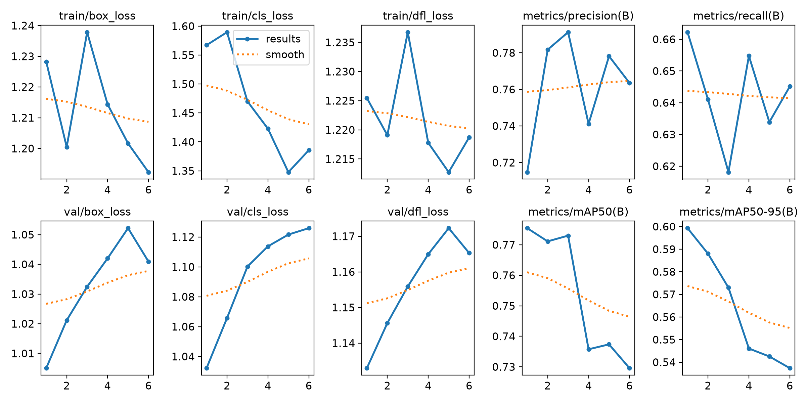
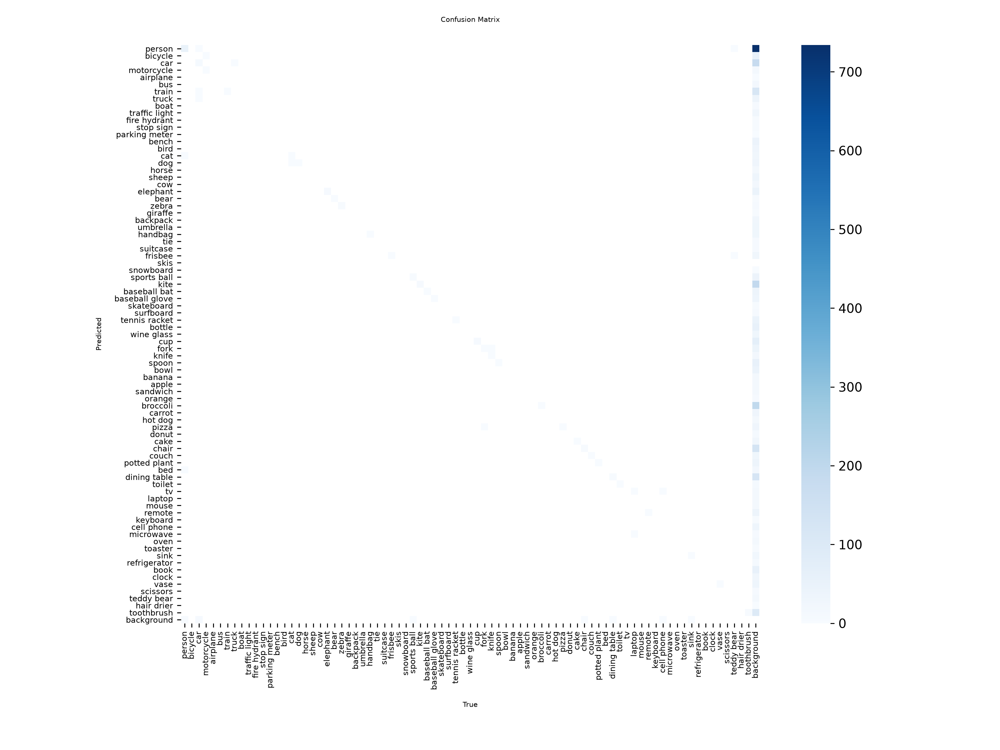
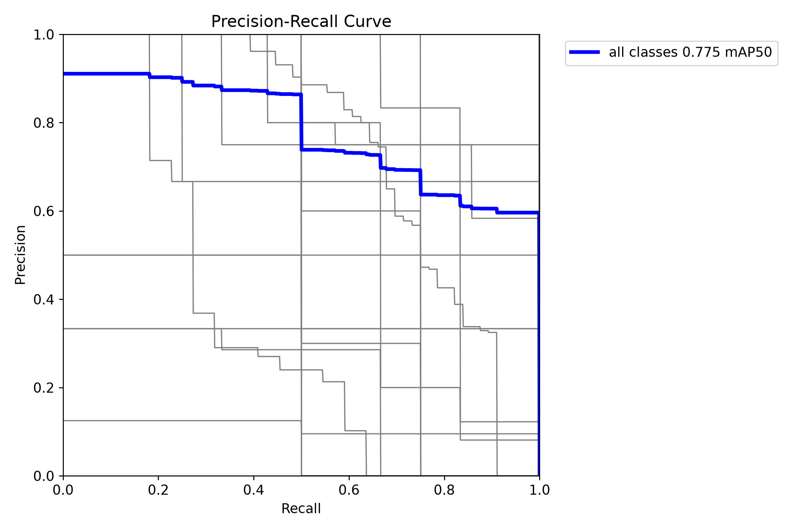

# YOLOv8 — Détection d'Objets, Segmentation d'Instances & Suivi Multi-Objets (ByteTrack)

> **Projet de Vision par Ordinateur — 3ᵉ année Cycle Ingénieur**  
> Application locale légère sous **PyTorch / Ultralytics YOLOv8 / OpenCV / Streamlit** avec pipeline complet de préparation de données, transfert d'apprentissage (*fine-tuning*), évaluation quantitative et suivi multi-objets.  
> **Dépôt GitHub :** [https://github.com/amenimili90-byte/YOLOv8-Image-Segmentation-Object-Detection-and-Tracking](https://github.com/amenimili90-byte/YOLOv8-Image-Segmentation-Object-Detection-and-Tracking)

---

## 1. Présentation du Problème & Cas d'Usage

### Problématique et cas d'usage métier : Surveillance & Mobilité Urbaine
Dans les systèmes de transport intelligents (ITS) et la surveillance vidéo automatisée, il est nécessaire d'extraire en continu des informations structurées à partir de flux visuels hétérogènes :
- **Identifier et localiser** précisément les usagers et véhicules (`car`, `truck`, `bus`, `motorcycle`, `bicycle`, `person`) ;
- **Segmenter** finement leurs contours (modèles `-seg`) pour isoler chaque instance ;
- **Suivre dans le temps** chaque entité avec un identifiant persistant (`track_id`) afin d'éviter le double comptage et d'analyser les trajectoires, les temps de présence et la fluidité du trafic.

### Entrées et Sorties du Système

| Type | Entrées | Sorties produites |
| :--- | :--- | :--- |
| **Image (`Image Processing`)** | Fichier `.jpg`, `.jpeg`, `.png` | Image annotée (`.png`), détections structurées (`.json`), tableau de comptage par classe, rapport `.csv`, latence (ms) et FPS |
| **Vidéo (`Video Processing`)** | Fichier `.mp4` | Vidéo annotée H.264 (`.mp4`), historique complet par frame (`.json`), rapport statistique des pistes (`.csv` : `track_id`, `class`, `avg_confidence`, `frames_present`), FPS moyens |

---

## 2. Architecture Technique de YOLOv8 & ByteTrack

### 2.1 Dimensions des Tenseurs & Flux de Données
Les images d'entrée sont redimensionnées avec conservation du ratio (*letterbox*) vers un tenseur normalisé de dimension :
$$\mathbf{X} \in \mathbb{R}^{B \times 3 \times 640 \times 640}$$
*(où $B$ est la taille du batch, $3$ les canaux RGB, et $640 \times 640$ la résolution spatiale standard).*

Le réseau extrait trois cartes de caractéristiques multi-échelles :
- **$P3$ (stride 8)** : $80 \times 80 \times C_3$ — détection des **petits objets** (piétons lointains, vélos) ;
- **$P4$ (stride 16)** : $40 \times 40 \times C_4$ — détection des **objets moyens** ;
- **$P5$ (stride 32)** : $20 \times 20 \times C_5$ — détection des **grands objets** (bus, camions proches).

### 2.2 Structure Modulaire de YOLOv8
1. **Backbone — CSPDarknet modifié (blocs `C2f` & `SPPF`) :**
   - Remplace les anciens blocs `C3` de YOLOv5 par des blocs **`C2f`** (*Cross-Stage Partial* avec deux convolutions et connexions résiduelles riches) pour un meilleur flux de gradient.
   - Termine par un bloc **`SPPF`** (*Spatial Pyramid Pooling - Fast*) qui agrège le contexte multi-échelle sans augmenter le coût de calcul.
2. **Neck — PANet / FPN Bidirectionnel :**
   - Fusionne les caractéristiques sémantiques profondes (voie *top-down* FPN) avec les informations spatiales fines des premières couches (voie *bottom-up* PAN).
3. **Decoupled Head (Tête Découplée Anchor-Free) :**
   - **Anchor-Free :** prédit directement les distances aux 4 bords de la boîte englobante sans boîtes d'ancrage prédéfinies (*anchors*), réduisant le nombre d'hyperparamètres et accélérant le NMS.
   - **Découplée :** sépare explicitement la branche de **classification** et la branche de **régression de boîte**.
   - **Branche Segmentation (`yolov8*-seg`, inspirée de YOLACT) :** génère $k = 32$ masques prototypes globaux combinés linéairement avec $k$ coefficients prédits par chaque instance détectée.

### 2.3 Fonctions de Perte (*Loss Functions*)
L'entraînement optimise une somme pondérée de trois termes principaux :
- **CIoU Loss (*Complete IoU*) :** régression géométrique des boîtes englobantes prenant en compte la surface de recouvrement, la distance entre centres et le ratio d'aspect.
- **DFL (*Distribution Focal Loss*) :** modélise les coordonnées des 4 bords sous forme de distributions discrètes de probabilités pour affiner la précision aux frontières ambiguës.
- **BCE (*Binary Cross-Entropy*) :** perte de classification multi-label par classe (et perte pixel-à-pixel sur les masques binaires pour les variantes `-seg`).

### 2.4 Suivi Multi-Objets avec ByteTrack
Contrairement aux approches naïves n'associant que les détections à forte confiance, **ByteTrack** couple un **filtre de Kalman** (prédiction de mouvement) et l'algorithme d'appariement hongrois (`lapx`) en **deux passes** :
1. Association des détections à **haute confiance** avec les pistes actives ;
2. Récupération des détections à **basse confiance** (occlusions partielles, flou de mouvement) pour maintenir les identifiants `track_id` sans fragmentation.

---

## 3. Améliorations Apportées par Rapport au Dépôt d'Origine

| Domaine | Implémentation d'origine | Nouvelle architecture optimisée |
| :--- | :--- | :--- |
| **Déploiement** | Conteneur Docker lourd (`Dockerfile`, `.dockerignore`) | Exécution locale native légère via `venv` Python + `requirements.txt` épinglé |
| **API Ultralytics** | Import obsolète `ultralytics.yolo.engine.results` et `boxes.boxes` | API moderne `ultralytics.engine.results` et `boxes.xyxy` / `masks.xy` |
| **Suivi (Tracking)** | `deep_sort_realtime` + appariement fragile via `np.isclose` sur la confiance + 10 000 `deque` pré-allouées | Tracker natif Ultralytics **ByteTrack** (`model.track(..., persist=True, tracker="bytetrack.yaml")`) avec `track_id` exacts et historique dynamique |
| **Mémoire & Vidéo** | `model.predict()` chargeant toutes les frames en RAM + FPS codé à `30` + `subprocess.call(...split(" "))` | Streaming `stream=True` à empreinte RAM constante + lecture du vrai `CAP_PROP_FPS` + `subprocess.run([...])` sécurisé |
| **JSON & Images** | Virgule finale invalide dans le JSON vidéo + mutation in-place de `result.orig_img` + matrices `mask` massives | JSON valide via `json.dump()`, copie explicite `.copy()`, option UI pour exclure les matrices `mask` lourdes |
| **Interface & Métier** | Pas de cache modèle, pas de choix CPU/GPU ni de métriques | `@st.cache_resource`, sélecteur `CPU`/`CUDA`, slider `conf`, comptage multi-classes, FPS/ms, exports directs (`MP4`, `PNG`, `JSON`, `CSV`) |
| **Pipeline ML Académique** | Absent | Dossier `ml_pipeline/` complet (`prepare_dataset.py`, `train.py`, `evaluate.py`) générant matrices de confusion, courbes PR et benchmarks FPS |

---

## 4. Structure du Dépôt

```text
YOLOv8-Image-Segmentation-Object-Detection-and-Tracking-main/
├── yolov8-segmentation-tracking.py   # Application Streamlit principale (best.pt par défaut, Image Processing & Video Processing)
├── best.pt                           # Poids YOLOv8n fine-tunés sur COCO128 (6 époques)
├── requirements.txt                  # Dépendances Python épinglées et compatibles en local
├── favicon-yolo.ico                  # Icône de l'application Streamlit
├── README.md                         # Documentation technique et support de rapport
├── LICENSE                           # Licence du projet
├── presentation_assets/              # Graphiques, matrices, courbes et résumés Markdown/JSON prêts pour la soutenance
│   ├── results.png
│   ├── confusion_matrix.png
│   ├── PR_curve.png
│   ├── F1_curve.png
│   ├── P_curve.png
│   ├── R_curve.png
│   ├── val_batch0_pred.jpg
│   ├── fps_benchmark.png
│   ├── metrics_summary.md
│   └── metrics_summary.json
└── ml_pipeline/                      # Pipeline ML modulaire (Données, Entraînement, Évaluation)
    ├── __init__.py
    ├── prepare_dataset.py            # Validation, nettoyage, split train/val et génération de data.yaml
    ├── train.py                      # Transfer Learning / Fine-tuning YOLOv8 avec sauvegarde des courbes
    └── evaluate.py                   # Évaluation model.val() -> presentation_assets/ & metrics/
```

---

## 5. Guide d'Installation et d'Utilisation Locale

### Étape 1 : Création et activation de l'environnement virtuel (`venv`)

**Windows (PowerShell) :**
```powershell
python -m venv venv
.\venv\Scripts\Activate.ps1
```

**Windows (Invite de commandes `cmd.exe`) :**
```cmd
python -m venv venv
venv\Scripts\activate.bat
```

**Linux / macOS :**
```bash
python3 -m venv venv
source venv/bin/activate
```

### Étape 2 : Installation des dépendances Python
```bash
pip install --upgrade pip
pip install -r requirements.txt
```

### Étape 3 : Installation système de `ffmpeg`
`ffmpeg` est requis pour le ré-encodage H.264 des vidéos annotées afin qu'elles soient lisibles dans le navigateur :

- **Windows (`winget`) :**
  ```powershell
  winget install Gyan.FFmpeg
  ```
  *(Redémarrez votre terminal après l'installation pour actualiser le `PATH`.)*
- **Linux (Ubuntu / Debian) :**
  ```bash
  sudo apt update && sudo apt install -y ffmpeg
  ```
- **macOS (Homebrew) :**
  ```bash
  brew install ffmpeg
  ```

### Étape 4 : Lancement de l'application Streamlit
```bash
streamlit run yolov8-segmentation-tracking.py
```
L'interface web s'ouvre automatiquement à l'adresse `http://localhost:8501`.

### Étape 5 : Utilisation du Pipeline ML (`ml_pipeline/`)

1. **Préparer et nettoyer un dataset au format YOLO :**
   ```bash
   python ml_pipeline/prepare_dataset.py --source-dir raw_dataset --output-dir ml_pipeline/dataset --classes person bicycle car motorcycle bus truck
   ```
2. **Entraîner / Fine-tuner un modèle YOLOv8 (`best.pt` est automatiquement exporté à la racine) :**
   ```bash
   python ml_pipeline/train.py --data ml_pipeline/dataset/data.yaml --model yolov8n.pt --epochs 6 --batch 8
   ```
3. **Évaluer le modèle et générer les métriques + benchmark FPS (`presentation_assets/` & `metrics/`) :**
   ```bash
   python ml_pipeline/evaluate.py --model best.pt --data ml_pipeline/dataset/data.yaml --output-dir presentation_assets
   ```
   *(Les artefacts `confusion_matrix.png`, `PR_curve.png`, `F1_curve.png`, `P_curve.png`, `R_curve.png`, `metrics_summary.md`, `metrics_summary.json`, `fps_benchmark.csv` et `fps_benchmark.png` sont enregistrés dans `presentation_assets/` et `metrics/`.)*

---

## 6. Résultats Expérimentaux, Dataset & Évaluation

### 6.1 Jeu de Données Utilisé (Source & Licence)
- **Dataset :** **COCO128** (sous-ensemble officiel Ultralytics extrait de *Microsoft COCO 2017*, 80 classes).
- **Source :** [`ultralytics/assets` — `coco128.zip`](https://github.com/ultralytics/assets/releases/download/v0.0.0/coco128.zip).
- **Licence :** Les images et annotations proviennent de MS COCO (**CC BY 4.0** pour les annotations ; les images restent soumises aux conditions Flickr d'origine décrites sur [cocodataset.org](https://cocodataset.org/#termsofuse)), et le packaging Ultralytics est distribué sous licence **AGPL-3.0**.
- **Nettoyage & Partitionnement (`ml_pipeline/prepare_dataset.py`) :**
  - `128` paires analysées $\rightarrow$ `2` images sans annotation (`000000000250.jpg`, `000000000508.jpg`) rejetées automatiquement ;
  - **`126` images valides** conservées et séparées en **`101` images d'entraînement (`train`)** et **`25` images de validation (`val`)** (`156` instances annotées en validation) dans `ml_pipeline/dataset/`.

### 6.2 Métriques Quantitatives Mesurées (`best.pt` — 6 époques, `640×640`)

Les résultats ci-dessous ont été mesurés localement sur processeur **Intel Core i5-9300H (2.40 GHz)** avec `PyTorch 2.9.1+cpu` et `Ultralytics 8.4.218` :

| Métrique Globale | Valeur mesurée |
| :--- | :---: |
| **Précision moyenne (Precision)** | `0.7155` |
| **Rappel moyen (Recall)** | `0.6626` |
| **mAP@50** | `0.7754` |
| **mAP@50-95** | `0.5993` |
| **Inférence pure (`model.val()`)** | `100.1 ms / image` |
| **Benchmark end-to-end CPU (`640×640`, 20 runs)** | `157.74 ± 11.64 ms / image` (**`6.34 FPS`**) |

#### Extrait des performances par classe (validation — 25 images, 156 instances)

| Classe | Precision | Recall | mAP@50 | mAP@50-95 |
| :--- | :---: | :---: | :---: | :---: |
| `person` | `0.8500` | `0.5893` | `0.7483` | `0.4922` |
| `car` | `0.6722` | `0.1871` | `0.3376` | `0.1994` |
| `motorcycle` | `0.8763` | `1.0000` | `0.9950` | `0.7455` |
| `train` | `0.3879` | `1.0000` | `0.9950` | `0.9950` |
| `truck` | `1.0000` | `0.0000` | `0.1095` | `0.0562` |
| `cat` | `1.0000` | `0.9730` | `0.9950` | `0.7213` |
| `dog` | `0.4615` | `1.0000` | `0.9950` | `0.8955` |
| `elephant` | `0.8119` | `0.8333` | `0.8263` | `0.6686` |
| `zebra` | `0.8231` | `1.0000` | `0.9950` | `0.9620` |

> Le tableau complet des 36 classes présentes dans le jeu de validation est disponible dans [`presentation_assets/metrics_summary.md`](presentation_assets/metrics_summary.md) et [`presentation_assets/metrics_summary.json`](presentation_assets/metrics_summary.json).

### 6.3 Visualisations Générées (`presentation_assets/`)

| Artefact | Description | Lien |
| :--- | :--- | :--- |
| Courbes d'apprentissage | Évolution des pertes (`box_loss`, `cls_loss`, `dfl_loss`) et métriques sur 6 époques | [`presentation_assets/results.png`](presentation_assets/results.png) |
| Matrice de confusion | Matrice brute & normalisée des prédictions vs vérité terrain | [`presentation_assets/confusion_matrix.png`](presentation_assets/confusion_matrix.png) |
| Courbe Précision-Rappel | Courbe PR globale et mAP@50 | [`presentation_assets/PR_curve.png`](presentation_assets/PR_curve.png) |
| Courbe Score F1 | Score F1 en fonction du seuil de confiance | [`presentation_assets/F1_curve.png`](presentation_assets/F1_curve.png) |
| Courbe Précision | Précision en fonction du seuil de confiance | [`presentation_assets/P_curve.png`](presentation_assets/P_curve.png) |
| Courbe Rappel | Rappel en fonction du seuil de confiance | [`presentation_assets/R_curve.png`](presentation_assets/R_curve.png) |
| Prédictions de validation | Lot de validation annoté par le modèle `best.pt` | [`presentation_assets/val_batch0_pred.jpg`](presentation_assets/val_batch0_pred.jpg) |
| Benchmark FPS | Latence et débit mesurés sur la machine | [`presentation_assets/fps_benchmark.png`](presentation_assets/fps_benchmark.png) |





---

## 7. Journal des Difficultés Techniques Résolues

Cette section synthétise les anomalies critiques identifiées lors de l'audit du projet initial et les solutions d'ingénierie mises en place :

1. **Incompatibilité d'API Ultralytics (`ModuleNotFoundError` & attributs dépréciés) :**
   - *Symptôme :* `from ultralytics.yolo.engine.results import Results` et `result.boxes.boxes` provoquaient des crashs ou avertissements sur `ultralytics >= 8.1.0`.
   - *Résolution :* Migration vers `from ultralytics.engine.results import Results`, `result.boxes.xyxy` et `result.masks.xy`.

2. **Crash de `ffmpeg` avec les noms de fichiers contenant des espaces :**
   - *Symptôme :* L'appel `subprocess.call(f"ffmpeg -i ...".split(" "))` découpait les chemins contenant des espaces en plusieurs arguments invalides.
   - *Résolution :* Passage d'une liste d'arguments explicite à `subprocess.run([...], check=True)` et ajout d'un contrôle préalable via `shutil.which("ffmpeg")` affichant un avertissement clair dans Streamlit.

3. **Fichier JSON vidéo syntaxiquement invalide :**
   - *Symptôme :* L'écriture manuelle `'[\n'` + `json.dump(..., json_file)` + `',\n'` + `']'` produisait une virgule finale interdite avant `]` (et ne fermait pas le descripteur de fichier).
   - *Résolution :* Agrégation structurée par frame et sérialisation via `json.dump(all_frames_json, json_file, indent=2)` dans un bloc `with open(...)`, avec option pour exclure les matrices binaires `mask` trop volumineuses.

4. **Saturation RAM sur les vidéos longues et vitesse de lecture incorrecte :**
   - *Symptôme :* `model.predict(video_file)` chargeait toutes les frames et résultats en mémoire vive avant la boucle ; le `VideoWriter` utilisait un FPS codé en dur à `30`.
   - *Résolution :* Activation de `stream=True` dans `model.track()` (traitement itératif frame par frame) et lecture dynamique du FPS réel via `cv2.CAP_PROP_FPS`.

5. **Appariement fragile des identifiants DeepSORT et pré-allocation mémoire excessive :**
   - *Symptôme :* L'ancien code associait les pistes via `np.isclose(track.det_conf, confidence)` (risque de collision si deux objets ont la même confiance) et allouait `10 000` objets `deque` inutiles.
   - *Résolution :* Remplacement par **ByteTrack** natif (`model.track(..., persist=True, tracker="bytetrack.yaml")`) fournissant `result.boxes.id` directement, couplé à un `defaultdict(lambda: deque(maxlen=30))`.

6. **Mutation en place de l'image source (`result.orig_img`) :**
   - *Symptôme :* Les fonctions de tracé modifiaient directement le tenseur/tableau `result.orig_img`, corrompant les accès ultérieurs.
   - *Résolution :* Duplication explicite avec `result.orig_img.copy()` avant tout tracé OpenCV.
